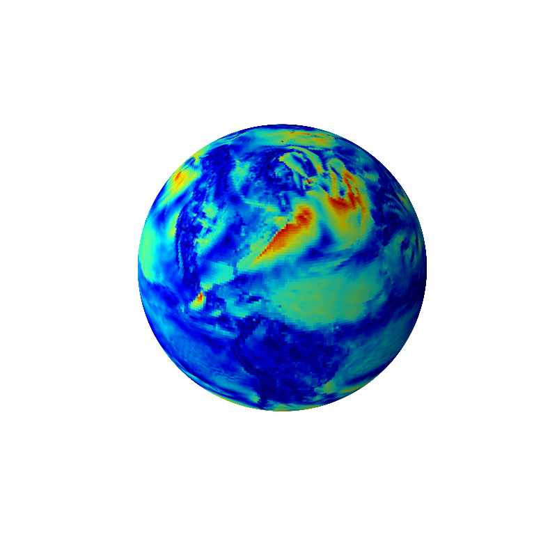
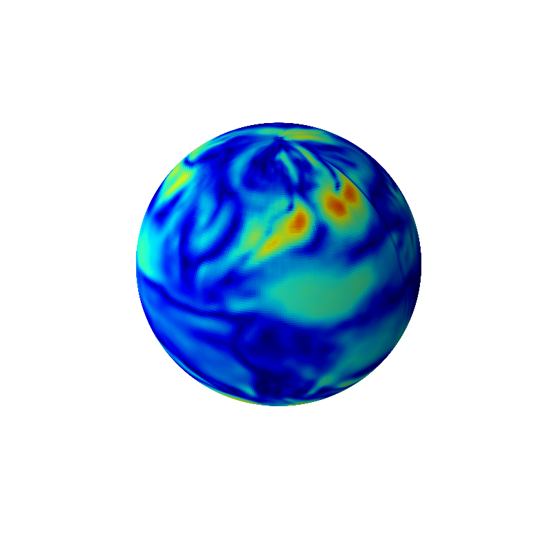
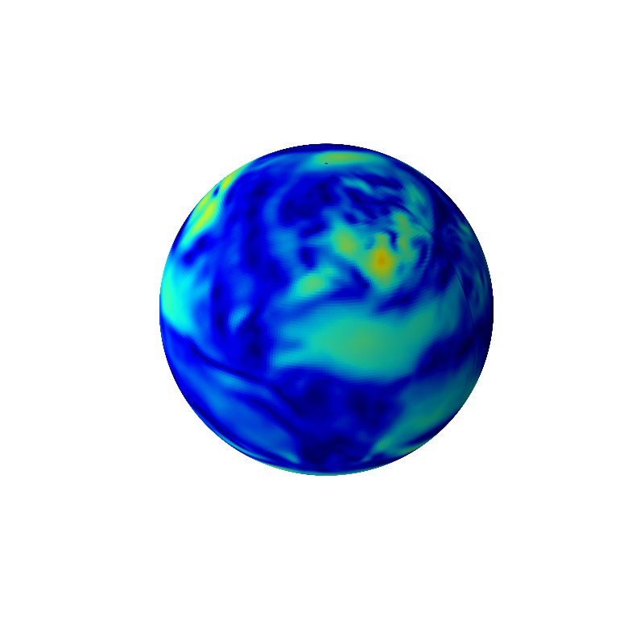
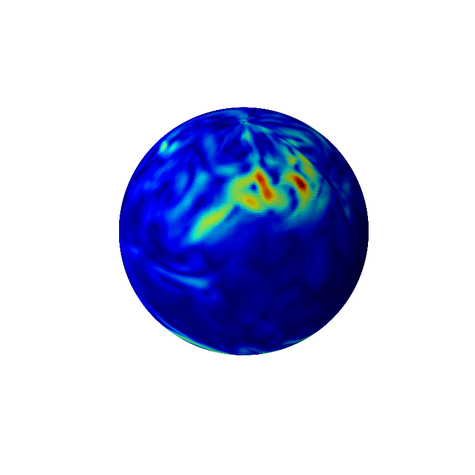
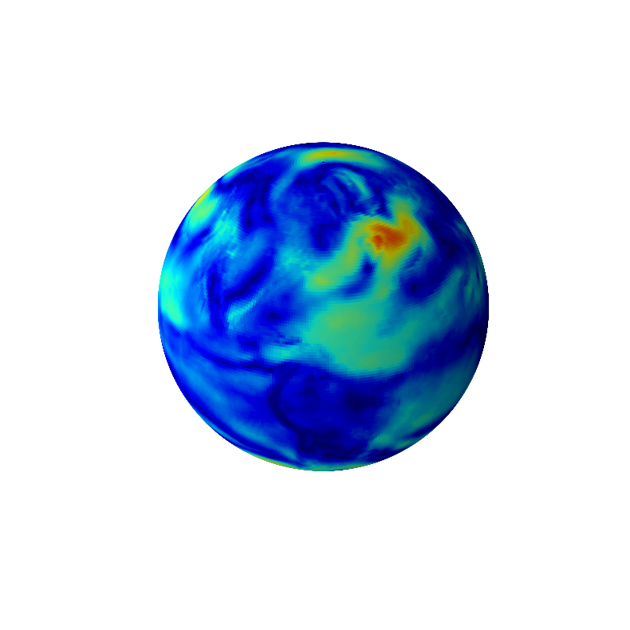
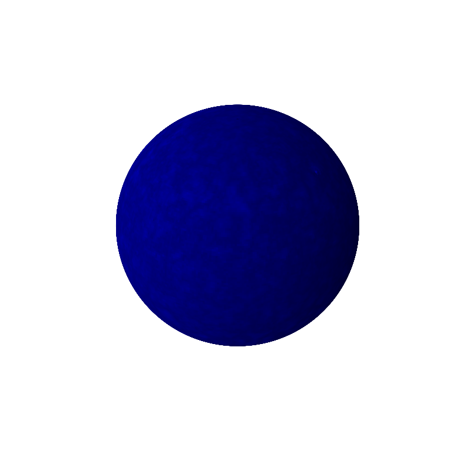
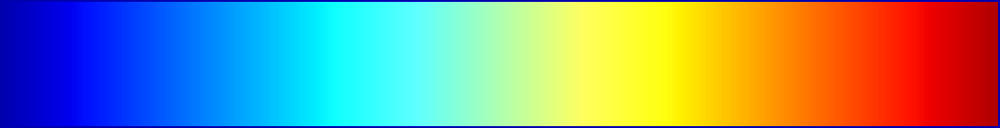

# S3CNN: Spin-weighted Smoothing Spherical CNN

Before running any script:

* install the dependencies (also in `requirements.txt`)
* run `generate_precomps.py` to precompute Wigner (small) d-matrices and test rotations
* download the dataset (or part of) from [here](https://universityofbergen-my.sharepoint.com/:f:/g/personal/francesco_ballerin_uib_no1/Epd3GwgY0s5Hp9Pij9lAhxsBEoJDfrdwgzoVC58_ojGl8g?e=5UvH2h)

## Rotation equivariance

Both an swsCNN and an S3CNN are SO(3)-equivariant up to numerical error, while a classical CNN on a lat/lon grid is not (except for rotations about the z-axis). The table below compares a classical CNN and an S3CNN on the wind-prediction task: both models are trained *without* rotation augmentation and then evaluated on an input rotated by Y(π/4). The S3CNN prediction is unchanged (up to numerical error) after rotating back to the original frame, while the CNN prediction is not.

<div align="center">
<table>
  <tr>
    <th>Model</th>
    <th>Ground truth</th>
    <th>Predicted, β=0</th>
    <th>Predicted, β=π/4</th>
    <th>Rotation error</th>
  </tr>
  <tr>
    <td>CNN</td>
    <td></td>
    <td></td>
    <td></td>
    <td></td>
  </tr>
  <tr>
    <td>S3CNN</td>
    <td></td>
    <td></td>
    <td></td>
    <td></td>
  </tr>
</table>
</div>

<p align="center"><i>0 km/h</i> &nbsp; &nbsp;<i>28 km/h</i></p>

Only the magnitude of the predicted wind vector field is shown. The rotation error (last column) is the difference between the β=0 and β=π/4 predictions, brought back to a common reference frame, which is negligible for the S3CNN, but large for the CNN.

## Precomputations
The precomputed files are stored in `precomp/` and are the coefficients used for FFT/iFFT as well as generating the random rotations performed during test.
These are:
```
precomp/SLICE_WIGNER_N0_<n_beta>_<MAX_L>.list
precomp/SLICE_WIGNER_N1_<n_beta>_<MAX_L>.list
precomp/FULL_WIGNER_<n_beta>_<MAX_L>.list
precomp/BDELTAS_<n_beta>_<MAX_L>.list
precomp/CONJ_PROD_<n_beta>_<MAX_L>.list
precomp/SINES_<n_beta>.torch
precomp/ROTATIONS_<N_ROTATIONS>.pckl
```
The files `precomp/SLICE_WIGNER_N0_<n_beta>_<MAX_L>.list` and `precomp/SLICE_WIGNER_N1_<n_beta>_<MAX_L>.list` contain a subset of the full Wigner $d$-matrices $d^l_{m,n}$ from $l=0$ to $l=$ MAX_L (included), considering only the column corresponding to spin $n=0$ and $n=1$ respectively (i.e. scalar and vector fields, in the notation of the paper). The angle $\beta$ is discretized according to `n_beta`, excluding the poles.

The file `precomp/FULL_WIGNER_<n_beta>_<MAX_L>.list` contains all the Wigner $d$-matrices $d^l_{m,n}$ from $l=0$ to $l=$ MAX_L discretized for `n_beta` equidistant angles from 0 to $\pi$ excluding the poles, indexed by $m,n\in\mathbb Z$, $-l\leq m,n \leq l$.

The file `precomp/BDELTAS_<n_beta>_<MAX_L>.list` contains the matrices $\Delta^l = d^l(\pi/2)$ from $l=0$ to $l=$ MAX_L, i.e. the Wigner $d$-matrices evaluated at $\beta=\frac{\pi}{2}$, used in the "Delta method" of the paper.

The file `precomp/CONJ_PROD_<n_beta>_<MAX_L>.list` consists of the precomputed products $\Delta^l_{s,m}\Delta^l_{s,n}$ of the $\Delta$ matrices (`BDELTAS`).

The file `precomp/SINES_<n_beta>.torch` consists of a precomputed mesh of the sine function ($\sin\beta$) used for the Delta FFT method.

The file `precomp/ROTATIONS_<N_ROTATIONS>.pckl` contains a list of randomly generated rotation angles used during test.

## Experiment types

| key                          | Description                                 
| ---------------------------- | -------------------------------------------------- |
| `wind->wind`                 | ERA5 wind (vector) to T+24h wind (vector)          |
| `temp->wind`                 | ERA5 temp (scalar) to T+0h wind (vector)           |
| `autoencoder`                | ERA5 wind (vector) compression to max 512 float32  |
| `MNIST-scalar-classification`| Classification of Spherical MNIST                  |
| `MNIST-vf-classification`    | Classification of Spherical MNIST with Sobel filt. |
| `MNIST-scalar-to-vector`     | Spherical MNIST to Spherical Sobel MNIST           |
| `MNIST-vector-to-scalar`     | Spherical Sobel MNIST to Spherical MNIST           |

## Models

We have implemented the following models. `S3CNN*` models are the proposed
**S3CNN** (spin-weighted smoothing spherical CNN: an SO(3) convolution
followed by a smoothing operator that projects back to S2 every layer);
`SwsCNN*` models are the **swsCNN** baseline (spin-weighted spherical CNN,
spin-restricted filters, Esteves et al.); `CNN*` models are the classical
Euclidean **CNN** baseline. A third architecture, **sCNN** (Cohen et al.,
the full psi^l_{m,n} group filter with no projection), exists as
`arch="scnn"` on the flat `SO3CNN` and is not yet wired into the model keys
below -- it needs pooling on the group. See `modules/architectures.py`.

| key                          | Description                                 
| --------------------- | --------------------------------------------------------- |
| `S3CNNUNet`           | UNet architecture with S3CNN layers                     |
| `SwsCNNUNet`          | UNet architecture with swsCNN layers                        |
| `CNNUNet`             | CNN UNet architecture (CNN baseline)                                    |
| `S3CNNAutoencoder`    | Autoencoder architecture with S3CNN layers              |
| `SwsCNNAutoencoder`   | Autoencoder architecture with swsCNN layers                  |
| `CNNautoencoder`      | Autoencoder architecture based on CNN (CNN baseline)                    |
| `S3CNNMNIST`          | Equivariant classifier based on S3CNN layers               |
| `SwsCNNMNIST`         | Equivariant classifier based on swsCNN layers                |
| `CNNMNIST`            | Classifier based on conv. layers (CNN baseline)                         |

### SO(3)-Equivariant models

| key           | Value             | Description                                 
| ------------- |-------------------| ------------------------------------------------------------ |
| `arch`        | `s3cnn`, `swscnn` or `scnn` | The architecture; see `modules/architectures.py` |
| `fft_method`  | `full` or `delta` | Only `full` is currently implemented. Fast but not sp.-eff.  |
| `n_alpha`     |  int              | Longitude resolution (usually 120 or 360)                    |
| `n_beta`      |  int              | Latitude resolution excluding poles (usually 59 or 179)      |
| `resolutions` |  list of ints     | List of maximum degree $l$ (band-limit) of Fourier coefficients at each layer |
| `widths`      |  list of ints     | List of channels at each layer                               |
| `spins`       |  list of lists    | List of spins $n\in\{0,1\}$ at each layer. Both = half channels each  |

```
model = SO3UNet(arch="s3cnn",
                fft_method="full",
                n_alpha = 360, n_beta=179,
                resolutions = [179, 100, 50, 100, 179],
                widths = [1, 2, 8, 30, 8, 1],
                spins = [[0,], [0,1], [0,1], [0,1], [0,1], [1,]],
                )
```

### CNN Models
| key           | Value             | Description                                 
| ------------- |---------------------------------------| ---------------------------------------- |
| `in_datatype` | `complex-scalar` or `complex-vector`  | Input type |
| `n_alpha`     |  int              | Longitude resolution (usually 120 or 360)                    |
| `n_beta`      |  int              | Latitude resolution excluding poles (usually 59 or 179)      |
| `widths`      |  list of ints     | List of channels at each layer                               |

```
model = CNNMNISTClassifier(in_datatype="complex-scalar",
                           n_alpha=120, n_beta=59,
                           widths=[1, 8, 32, 128, 256, 512])
```

## Dataset

Datasets are Spherical and have a common class.

### ERA5 Dataset
The dataset needs to be retrieved and is stored in `dataset/` and is organized by year. Example:
```
dataset
├── type (e.g. wind->wind, temp->wind, ...)
    ├── 2000
    │   ├── X
    │   │   ├── 0.npy
    │   │   ├── 1.npy
    │   │   ├── ...
    │   │   └── 8735.npy
    │   └── Y
    │       ├── 0.npy
    │       ├── 1.npy
    │       ├── ...
    │       └── 8735.npy
    ├── 2001
    │   ├── X
    │   │   └── ...
    │   └── Y
    │       └── ...
    ├── ...
    └── 2020
        ├── X
        │   └── ...
        └── Y
            └── ...
```
`type` can be a folder or nested folders, and is used to differentiate between different types of datasets (scalar to vector, vector to vector...) as well as the coarseness of the dataset (lat/lon grid or coarseness in time).

```
WeatherDataset(root = "dataset/wind->wind/weekly_coarse_torch/",
               folders=train_folders,
               train=True,
               in_datatype="vector", out_datatype="vector")
```

### Spherical MNIST Dataset

The data is not saved locally but retrieved on first runtime through the the Pytorch module when calling the `SphericalMNISTDataset` class the first time.

```
SphericalMNISTDataset(split="train", mode="equirectangular",
                      n_alpha=120, n_beta=59,
                      in_datatype="scalar", out_datatype="label")
```

## Logs

Training logs and figures are saved under `experiments/`, divided by experiment type (wind->wind, temp->wind, autoencoder, ...). If any error arises, initialize the empty folders.

## Training / Testing

To train the models simply schedule the experiments to be executed in the `train_schedule/schedule.py` and execute the file ```run_all_experiments.py``` with the desired GPUs. Execution proceeds in parallel w.r.t. the GPUs.

Example: 
```
$ python run_all_experiments.py --GPU 0
$ python run_all_experiments.py --GPU 2,3,5
```

A train schedule job and will result in a log being generatered which also contains the weights of the best performing iteration. At starttime an id will be assigned to the job. It has the following keys:
| key             | Values                                 | Default   |
| --------------- | -------------------------------------- | --------- |
| `model_type`    | Name of the model (string)             | None      |
| `experiment`    | `"wind->wind"`, `"temp->wind"`, ...    | None      |
| `total_epochs`  | Any positive integer                   | None      |
| `early_stopping`| Any positive integer                   | None      |
| `save_every`    | Any positive integer                   | None      |
| `batch_size`    | Any positive integer                   | None      |
| `fft_method`    | `"delta"`, `"full"` (not used for CNN) | `"full"`  |
| `dataset_size`  | Any positive integer                   | None      |
| `rotate`        | `"no"`, `"random"`                     | None      |
| `log_id`        | String                                 | None      |

A test schedule job requires the corresponding training job to have been executed first. It requires the following keys:

| key             | Values                                 | Default   |
| --------------- | -------------------------------------- | --------- |
| `model_type`    | Name of the model (string)             | None      |
| `experiment`    | `"wind->wind"`, `"temp->wind"`, ...    | None      |
| `path`          | Relative path of the training folder   | None      |
| `batch_size`    | Any positive integer                   | None      |
| `fft_method`    | `"delta"`, `"full"` (not used for CNN) | `"full"`  |
| `rotate`        | `"no"`, `"beta"`, `"full"`             | None      |


## Plots

To generate the plots use the files `plot_windwind.py`, `plot_tempwind.py`, and `plot_autoencoder.py`. The files have to be filled in with the ids from the logs that have been run.

## Credits

- Francesco Ballerin (Universitetet i Bergen - Department of Mathematics)
- Erlend Grong (Universitetet i Bergen - Department of Mathematics)
- Nello Blaser (Universitetet i Bergen - Department of Informatics)

For any question: francesco@ballerin.it .